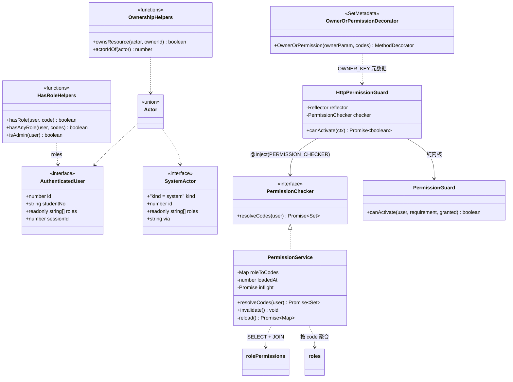
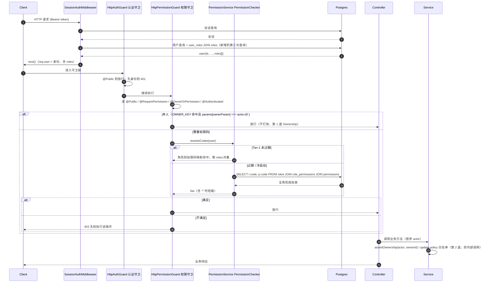
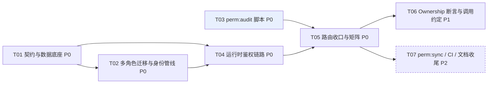

# RBAC 动态权限 + 权限点漏标检测脚本 · 设计方案（v2 · 定稿）

> 目标：`/Users/wermdany/Code/typescript-starter`（NestJS 12 + TS 6 + 纯 ESM + drizzle + Postgres 17）
> 在既有「登录态 + `@AdminOnly()`」之上，落地**数据库驱动的动态 RBAC**，并提供**一条命令可跑的路由漏标静态检测脚本**。
> 本文档只出方案，不写实现代码。
>
> **定稿状态**：本文档已无待确认事项 —— 原 §9 已替换为**「决策定稿」表**（8 项全部拍板），其中含一项明确取舍：**内部调用防越权不做脚本化检查**（`svc:audit` 已取消），其后果记录在 §9 的「已知弱点」与 §10.4。
>
> **v2 依据用户已拍板的决策修订**（落地集中在第 10 章，最终取值见 §9）：
> - **D1** 角色存储改为**多角色**（`user_roles` 关联表，权限取并集） —— 推翻 v1 §2.2 的方案 A
> - **D2** 超级管理员 = `admin` 角色本身定义为「超级管理员」，长期持有通配 `*` —— 推翻 v1「迁移期临时」的设定
> - **D3** `GET /users/:id` 收口为 `user:read` —— 推翻 v1 的保守建议
> - **D4** 新增领域：**本人权限（Ownership）与内部调用越权**
> - **D5~D8**（定稿轮追加）：`users.role` **一次性删除**；响应契约 `role`→`roles[]` **一次性断裂**；`roles.code` 用 **varchar(32)**；多角色冲突取 **并集**；**内部调用不做脚本化检查**（`svc:audit` 取消）
>
> 仍成立的三条基础约束：① RBAC 纯动态（落库、运行时可配）；② 检测脚本只查「路由漏标」且不连库；③ 脚本只做独立脚本（`pnpm perm:audit`），不进 vitest、不绑 `pnpm test`。

---

## 0. 结论速览（v2 · 定稿）

| 议题 | 结论 | 一句话理由 / 放弃什么 |
| --- | --- | --- |
| 角色形态 | **多角色**：`user_roles(user_id, role_id)`，权限取**并集** | 放弃并集之外的冲突语义（无拒绝优先，见 §10.1） |
| `users.role` | **删除单值列**（迁移内回填 `user_roles` → 校验 → `DROP COLUMN`） | `AuthenticatedUser.role` → `roles: readonly RoleCode[]`（`UserRole` 退化为"内置角色"字面量联合），**TypeScript 会替你找出全部消费点**（实测 ~20 个文件 / 35 处）；放弃非破坏性升级 |
| `roles.code` 类型 | **`varchar(32)` + unique**（不再用 `pgEnum`） | 真正实现「运行时增删角色不加迁移」；放弃编译期的角色全集检查（`UserRole` 退化为"内置角色"字面量联合） |
| 缓存粒度 | **仍按角色缓存（Tier-1）**，请求内内存取并集 | 关键前提：**用户的角色集合不缓存**（每次请求随会话查库）⇒ 保住「改角色立即生效」语义；放弃 per-user LRU 的复杂度 |
| 多角色的每请求代价 | 认证中间件从 **2 次查询变 3 次**（会话 / 用户 / 角色），可合成 2 次 | 诚实说明：这是选多角色付出的硬成本，单角色方案本可每请求零新增查询 |
| 响应契约 | `role` → `roles: UserRole[]`（登录响应、用户投影受影响） | **破坏性前端变更**，需配合改；替代方案见 §2.5 |
| 超级管理员 | `roles(code='admin', name='超级管理员')` 长期持 `*`；可读性靠**脚本生成的矩阵文档**（§3.4） | 放弃「日常也必须显式授权」的可审计性，改用矩阵文档 + CI 漂移校验补偿 |
| 本人权限 | `@OwnerOrPermission(ownerParam, ...codes)` 装饰器 + service 内 `assertOwnership()` **两道都做** | 放弃"只在 service 里手写 `isSelf`"（散落且静态不可审）；新增一个可被脚本识别的标记 |
| 内部调用越权 | 约定：**写操作首参必须是 `actor: Actor`**（唯一能被类型系统兜住的一条）+ service 内断言 + `systemActor(reason)` 后门留痕；**不做脚本化检查**，靠 AGENTS.md 约定 + code review | 放弃自动化拦截：R2/R4/R5 只能靠 review 发现，见 §9 的「已知弱点」红块 |
| 新增依赖 | **仍然零新增** | 扫描用 devDeps 的 `typescript`；同步脚本用已有 `pg` + `dotenv` |

---

## 1. 现状与缺口分析

> 本章为 v1 原文结论，多角色（D1）不改变这些痛点，仅改变解法的成本结构。

### 1.1 现状盘点（已读源码确认）

| 层 | 现有实现 | 文件 |
| --- | --- | --- |
| 身份注入 | `SessionAuthMiddleware`：有 Bearer 头才查库，结果写 `req.user`；失败不短路 | `src/modules/auth/session/session-auth.middleware.ts` |
| 登录态守卫 | `AuthGuard`（纯逻辑，不碰 HTTP / 不查库）+ `HttpAuthGuard`（`APP_GUARD`，读 `@Public()` / `@AdminOnly()`，方法级覆盖类级） | `src/shared/auth/auth.guard.ts`、`auth.module.ts` |
| 标记装饰器 | `@Public()` / `@AdminOnly()` / `@CurrentUser()` | `src/shared/auth/decorators/*.decorator.ts` |
| 角色契约 | `UserRole = 'student'|'teacher'|'admin'`、`ADMIN_ROLE`、`isAdmin()`（注释写明：全部越权判定唯一入口） | `src/common/auth/auth.contract.ts` |
| 角色存储 | `users.role` 单值 pgEnum 列 | `src/database/schema/users.schema.ts` |
| 字段级权限 | `update-policy.ts`：角色 → 可改字段白名单 | `src/modules/user/update-policy.ts` |
| 控制器 | 4 个 / **23 条路由**（实测扫描结果，见 §4） | `auth.controller.ts`、`session/session.controller.ts`、`log/login-log.controller.ts`、`user/user.controller.ts` |

路由标记现状（实测）：`@Public()` 3 条、`@AdminOnly()` 10 条、**无任何标记 10 条**。

### 1.2 痛点与缺口

| # | 痛点 | 具体表现 | 后果 |
| --- | --- | --- | --- |
| P1 | **权限粒度 = 角色粒度** | `@AdminOnly()` 把「能删用户」「能看他人会话」「能重置密码」压成一个布尔；`teacher` 想要「看列表但不能删」只能改代码 | 每次权限细分都是一次发版 |
| P2 | **新增角色必改代码** | 角色集合是 pgEnum + TS 类型镜像，加 `auditor` 要改 schema / 迁移 / `UserRole` / DTO / `update-policy` | 角色是可运营数据，不该是编译期常量 |
| P3 | **「登录即可」没有显式表达** | 10 条路由无标记，靠"有没有 `@CurrentUser()`"与 service 内部判断表达语义 | 脚本分不清「忘了写」与「本就只要登录」——漏标无法被静态检测的根因 |
| P4 | **本人 vs 他人没有统一表达机制** | `UserService.update()` 里 `actor.id !== id && !isAdmin` 手写；`changePassword` 里又抄一遍；`SessionService` 的 `revokeMine` 又是第三种写法 | 同一条规则 N 种写法，Review 靠人肉 |
| P5 | **内部调用没有鉴权** | service 之间直接 import 调用（`UserService → SessionService`），不经过任何守卫；`softDelete(id)` / `restore(id)` / `revokeAllForUser(id, …)` 只接收目标 id | 任何上层写错一个 id 就能删别人；约定只存在于口头 |
| P6 | **权限点没有清单** | 没有任何地方回答「系统里有哪些可被拒绝的动作」 | 无法做角色矩阵 review |
| P7 | **已存在的过度授权（静态即可看出）** | `GET /users/:id` 无标记 ⇒ 任意登录用户可查任意用户资料（含 email），而 `GET /users` 却是 `@AdminOnly()` | 前后不一致的越权面（D3 已决定收口） |

> P4 / P5 在 v1 里只是点到，用户此次明确将其纳入范围 ⇒ 见第 10 章的完整机制。

---

## 2. 数据模型（v2：多角色）

### 2.1 四张表（`src/database/schema/rbac.schema.ts`）

严格对齐 `AGENTS.md` §15 的写法：显式物理列名、时间戳只来自 `...timestamps()`、索引在第三个参数里显式命名。

| 表 | 作用 | 关键约束 |
| --- | --- | --- |
| `roles` | 角色字典 | `code varchar(32)` **unique**（不再是 pgEnum）；`level` 决定"主角色"展示优先级；`is_system` 防误删 |
| `permissions` | 权限点字典 | `code varchar(64)` 列级 unique；`group` 供管理端分组 |
| `role_permissions` | 角色 ↔ 权限多对多 | `(role_id, permission_id)` 复合唯一；双 FK `cascade` |
| **`user_roles`** | **用户 ↔ 角色多对多**（D1 新增） | `(user_id, role_id)` 复合唯一；双 FK `cascade`；反向索引 `role_idx` 供"列出该角色所有成员" |

```ts
// 形如（示意，非最终代码）
export const roles = pgTable(
  'roles',
  {
    id: integer().primaryKey().generatedAlwaysAsIdentity(),
    // varchar 而非 pgEnum：真正实现"运行时新增角色不需要 migration"
    code: varchar('code', { length: 32 }).notNull(),
    name: varchar('name', { length: 50 }).notNull(),       // '超级管理员' / '教师' / '学生'
    description: varchar('description', { length: 200 }),
    /** 展示用优先级（数大者优先）；多角色只有展示需要它，判定一律取并集 */
    level: integer('level').notNull().default(0),
    isSystem: boolean('is_system').notNull().default(true),
    ...timestamps(),
  },
  (t) => [
    // 软删后 code 可复用 ⇒ 用部分唯一索引而非列级 unique
    uniqueIndex('roles_code_alive_idx').on(t.code).where(sql`${t.deletedAt} IS NULL`),
  ],
);

export const permissions = pgTable(
  'permissions',
  {
    id: integer().primaryKey().generatedAlwaysAsIdentity(),
    code: varchar('code', { length: 64 }).notNull().unique(),   // 'user:create' | '*'
    name: varchar('name', { length: 64 }).notNull(),
    description: varchar('description', { length: 200 }),
    group: varchar('group', { length: 32 }).notNull().default('general'),
    isSystem: boolean('is_system').notNull().default(true),
    ...timestamps(),
  },
  (t) => [index('permissions_group_idx').on(t.group)],
);

export const rolePermissions = pgTable(
  'role_permissions',
  {
    id: integer().primaryKey().generatedAlwaysAsIdentity(),
    roleId: integer('role_id').notNull().references(() => roles.id, { onDelete: 'cascade' }),
    permissionId: integer('permission_id').notNull().references(() => permissions.id, { onDelete: 'cascade' }),
    ...timestamps(),
  },
  (t) => [
    uniqueIndex('role_permissions_role_permission_idx').on(t.roleId, t.permissionId),
    index('role_permissions_permission_idx').on(t.permissionId),
  ],
);

export const userRoles = pgTable(
  'user_roles',
  {
    id: integer().primaryKey().generatedAlwaysAsIdentity(),
    userId: integer('user_id').notNull().references(() => users.id, { onDelete: 'cascade' }),
    // 存 role_id 而非 role_code：允许将来重命名角色的展示名与 code 而不动数据
    roleId: integer('role_id').notNull().references(() => roles.id, { onDelete: 'cascade' }),
    /** 授权来源（seed / migration / admin:{id} / api），留痕用 */
    grantedBy: varchar('granted_by', { length: 64 }),
    ...timestamps(),
  },
  (t) => [
    uniqueIndex('user_roles_user_role_alive_idx').on(t.userId, t.roleId).where(sql`${t.deletedAt} IS NULL`),
    index('user_roles_role_idx').on(t.roleId),
    // 每次认证请求的唯一热点查询（见 §3.3）
    index('user_roles_user_alive_idx').on(t.userId).where(sql`${t.deletedAt} IS NULL`),
  ],
);
```

### 2.2 `users.role` 单值列怎么处置（D1-①）

| 方案 | 做法 | 代价 | 结论 |
| --- | --- | --- | --- |
| **A 删除列**（推荐） | 迁移内：回填 `user_roles` → 校验行数 → `ALTER TABLE users DROP COLUMN role` → `DROP TYPE user_role` | **最大但一次性**：响应契约 `role`→`roles[]` 是破坏性前端变更；DTO / 投影 / 列表筛选全部要改（实测 ~20 文件 / 35 处） | ✅ 推荐 |
| B 保留为冗余只读 | 列留着不再更新 | **立即变谎言**：管理端改角色后 `users.role` 陈旧，读的人不知道该信谁 | ❌ 不接受 |
| C 双写（触发器同步） | 用 trigger 让 `users.role` 跟随 `user_roles` 的主角色 | 多一处可写事实来源；触发器难测难调；等于永久背着一个兼容包袱 | ⭕ 仅作过渡期的临时台阶（≤ 一个迭代），不建议作为常态 |

**推荐 A，并把破坏性暴露提前解析**：`AuthenticatedUser.role` 字段**直接删除**（而不是新增 `roles` 后再留 `role`），这样 TypeScript 会替你把全仓消费点一次性标红——这是"借编译器做全量排查"的便宜手段，比人工 grep 可靠。

**回填迁移写法**（`drizzle/0005_rbac_backfill.sql`，与 drop column 同批次执行，中间加一道校验）：

```sql
-- ① 回填：把既有 users.role 灌进 user_roles
INSERT INTO user_roles (user_id, role_id, granted_by, created_at, updated_at)
SELECT u.id, r.id, 'migration:0005', now(), now()
FROM users u
JOIN roles r ON r.code = u.role          -- roles 必须先于本条迁移完成 seed
ON CONFLICT DO NOTHING;

-- ② 校验（人工确认 0 行差异后再执行 ③）
-- SELECT count(*) FROM users u WHERE NOT EXISTS (
--   SELECT 1 FROM user_roles ur JOIN roles r ON r.id = ur.role_id
--   WHERE ur.user_id = u.id AND r.code = u.role);
-- 期望返回 0

-- ③ 删除单值列（注意：本仓库 seed 有约 10 万行 users，DROP COLUMN 是元数据操作，
--    回填 INSERT 是一次性扫描，均在秒级；生产环境请低峰执行并先备份）
ALTER TABLE users DROP COLUMN role;
DROP TYPE IF EXISTS user_role;           -- roles.code 已改为 varchar，枚举不再需要
```

诚实提示：本仓库 `drizzle/0001_seed_users.sql` 灌了 **100,000 行**用户数据，回填是 10 万行 INSERT。本地/开发环境秒级完成、无需分批；真实生产库请改为 `WHERE u.id BETWEEN …` 分批 + 低峰执行。

### 2.3 契约演进：`UserRole` / `ADMIN_ROLE` / `isAdmin()`（D1-②）

`src/common/auth/auth.contract.ts`：

| 现状 | v2 | 说明 |
| --- | --- | --- |
| `role: UserRole`（标量） | **`roles: readonly RoleCode[]`** | 删字段而非加字段 ⇒ 编译器找出全部消费点 |
| `UserRole = 'student'\|'teacher'\|'admin'` | **保留**，语义改为「内置角色」字面量联合 | 同时新增 `type RoleCode = string`（运行时可取任意落库值） |
| `ADMIN_ROLE` | 保留不变 | 仍是"哪个是超管"的唯一出处 |
| `isAdmin(user)` | **保留同名同形**，内部改为 `hasRole(user, ADMIN_ROLE)` | 「禁止手写 `role === 'admin'`」这条规矩的写法变成「禁止手写 `roles.includes('admin')`」，入口仍是这一个函数 |
| — | 新增 `hasRole(user, code)` / `hasAnyRole(user, codes)` | 多角色下的判定原语，全部判定都从这里出发 |

```ts
export type UserRole = 'student' | 'teacher' | 'admin';   // 内置角色：数据库侧已无此约束，仅供代码引用
export type RoleCode = string;                             // 运行时真实值

export interface AuthenticatedUser {
  id: number;
  studentNo: string;
  nickname: string;
  roles: readonly RoleCode[];      // ← 替代 role，来自 user_roles JOIN roles
  sessionId: number;
}

export function hasRole(u: Pick<AuthenticatedUser, 'roles'>, code: RoleCode): boolean {
  return u.roles.includes(code);
}
export function hasAnyRole(u: Pick<AuthenticatedUser, 'roles'>, codes: readonly RoleCode[]): boolean {
  return codes.some((c) => hasRole(u, c));
}
/** 超级管理员判定的唯一入口（原 isAdmin 的语义与调用点保持不变） */
export function isAdmin(u: Pick<AuthenticatedUser, 'roles'>): boolean {
  return hasRole(u, ADMIN_ROLE);
}
```

**受影响且必须同步改造的消费点**（实测 grep 结果，任务 T02 的验收清单）：

| 类别 | 文件 |
| --- | --- |
| 身份构造 | `session/session-auth.middleware.ts`（`role: user.role` → `roles: user.roles`）、`session/session.service.ts` `findAuthUserById` |
| 登录/续期/当前身份 | `login/account.service.ts`（`AuthUser['role']`）、`login/login.service.ts`、`login/refresh.service.ts`、`login/me.service.ts`（`MeResult.user.role`）、`login/dto/user.dto.ts`（`authUserColumns` / `userSummaryColumns`） |
| 用户域投影与 DTO | `user/user.projection.ts`（`userPublicColumns.role`）、`dto/create-user.dto.ts`、`dto/update-user.dto.ts`（入参含 role）、`dto/query-users.dto.ts`（按角色筛选） |
| 用户域逻辑 | `user.service.ts`（create 写 `role`、findAll 的 `eq(users.role, query.role)`、`update` 的 outside 判定、`changePassword` 的自助判定）、`update-policy.ts` |
| 守卫 | `shared/auth/auth.guard.ts`（`isAdmin(user)` 形不变，但夹具要改） |
| 测试夹具 | `shared/auth/__tests__/auth.guard.spec.ts`、`user/__tests__/update-policy.spec.ts`、`auth/__tests__/login/*`、`auth/__tests__/session/*`、`__tests__/bootstrap.spec.ts`（含一条期望 `role: 'admin'` 的响应断言） |
| 导出 | `shared/auth.ts` barrel（新增 `hasRole` / `hasAnyRole` / `RoleCode` / `Actor` 系列） |

> `src/shared/validation/__tests__/trimmed.spec.ts` 与 `shared/http/__tests__/zod-validation.pipe.spec.ts` 里的 `role` 是本地测试 schema，**与业务无关，不需要改**。

### 2.4 `AuthenticatedUser` 与中间件的取舍（D1-③）

| 方案 | 内容 | 评价 |
| --- | --- | --- |
| **A（推荐）** `roles` 放进 `AuthenticatedUser`，中间件每次请求从库读 | 中间件在拿到用户后追加一次角色查询（或合成一条 JOIN+`array_agg`） | ✅ 语义最干净：身份来源仍是「会话 + 用户表」这一语义未变；✅ 改角色下一次请求即生效，无需失效任何缓存；❌ 每请求多 1 次查询（可用 JOIN 合成少一次） |
| B `roles` 写进 accessToken，JWT 自包含 | token 里带 roles，中间件不查库 | ❌ 与该中间件现有注释「不信任 token 里的任何内容」直接冲突；改角色要等 token 过期才知道 ⇒ 违背现有设计取向，明确不采用 |
| C 中间件只给 id，service 按需自己查角色 | 延迟到业务层再查 | ❌ 每个 service 都要记得查 ⇒ 权限判定散落，正是本方案要消灭的形态 |

**推荐 A 的推荐写法**：先做**两次查询**（查用户一条、查 `user_roles JOIN roles` 一条，drizzle 表达简单、可读），把合并成一条 SQL 留作性能优化选项（届时用 `sql`\`array_agg\` 片段）。不要在第一步就引入难读的聚合 SQL。

### 2.5 响应契约的变化（`role` → `roles`）

删除 `users.role` 后，所有"向外返回 role"的地方都要改造，推荐 **P-b + P-a 组合**：

| 方案 | 做法 | 适用 |
| --- | --- | --- |
| **P-b（默认）聚合子查询** | 投影里加一列 `roles: sql<RoleCode[]>\`(select coalesce(array_agg(r.code), '{}') from user_roles ur join roles r on r.id = ur.role_id where ur.user_id = users.id and ur.deleted_at is null)\`.as('roles')` | 单条详情、`/auth/me`、登录响应用户摘要：一次查询拿到全部字段，无 N+1 |
| P-a（列表备选）二次查询 + 内存 attach | 先查主表，再 `WHERE user_id = ANY($ids)` 查一次全部角色，内存分组后 attach | `GET /users` 分页（pageSize ≤ 100）若担心相关子查询开销时使用 |

- 落地位置：`user.projection.ts` 的 `userPublicColumns` 增加 `roles`；`login/dto/user.dto.ts` 的 `authUserColumns` / `userSummaryColumns` 同步；DTO 的 `role` 入参改为 **`roles: RoleCode[]`（创建/更新时批量设置角色）**，`query-users.dto.ts` 的 `role` 筛选改为 `roles`（任一匹配）。
- ⚠️ **这是破坏性前端变更**：`role: 'student'` → `roles: ['student']`。**已拍板走一次性断裂**（§9 决策 #2），不再提供并行返回的过渡形态。

### 2.6 类图（v2）



---

## 3. 运行时鉴权链路（v2）

### 3.1 新增/修改的运行时件

| 件 | 位置 | 说明 |
| --- | --- | --- |
| `PERMISSION_KEY` / `@RequirePermission(...codes)` | `src/shared/auth/decorators/rbac.decorator.ts`（新） | AND 语义（全部具备） |
| `OWNER_KEY` / `@OwnerOrPermission(ownerParam, ...codes)` | 同上（追加） | **D4**：本人（`params[ownerParam] === actor.id`）或持有 `codes` 任一；`codes` 可为空 ⇒ 纯本人。详见 §10.2 |
| `AUTHENTICATED_KEY` / `@Authenticated()` | `src/shared/auth/decorators/auth.decorator.ts`（改） | 「登录即可」的显式意图标记，是脚本可判定性的前提 |
| `PermissionGuard`（纯逻辑，同步可测） | `src/shared/auth/auth.guard.ts`（改，追加） | 入参 `(user, requirement, granted)` + owner 分支；不含 IO |
| `HttpPermissionGuard` | 同上 | 读四类元数据 → 解析 owner → 调 `PermissionChecker` → 调纯内核；跳过 `@Public()`；无 `req.user` 直接 401（**使两个守卫注册顺序无关**） |
| `PermissionChecker` 接口 + DI token | `src/common/auth/permission.contract.ts`（新） | `resolveCodes(user)` —— **入参是 user 而非 role**，多角色并集在实现类里完成，将来换存储不动接口 |
| `Actor` / `SystemActor` / `ownsResource()` | `src/common/auth/ownership.contract.ts`（新） | 纯类型与纯谓词（**不依赖 Nest**） |
| `assertOwnership()` | `src/shared/auth/ownership.ts`（新，无后缀工具类，与 `update-policy.ts` 同类） | 抛 `ForbiddenException` 的断言，service 内使用 |
| `PermissionService` | `src/modules/rbac/permission.service.ts`（新） | 实现 `PermissionChecker`：Tier-1 角色→权限缓存 + 请求内并集 |
| `RbacModule` | `src/modules/rbac/rbac.module.ts`（新） | 自注册 `APP_GUARD`（遵循 AGENTS.md「谁提供能力谁注册」）+ 提供 `PERMISSION_CHECKER` |

依赖方向校验：`common`（纯类型）← `shared`（守卫/断言，依赖 `common`，**不依赖业务、不依赖 DB**）← `modules/rbac`（依赖 `shared` + `database`）✅ 满足 AGENTS.md 的依赖方向。

### 3.2 判定顺序（伪代码）

```ts
// HttpPermissionGuard.canActivate
targets = [handler, class]                        // Reflector 覆盖语义：方法级优先
if (Public(targets))  return true                 // ① 公开路由直接放行
user = request.user                               // ② 中间件产物（roles 已随请求查库得到）
if (!user) throw Unauthorized(401)                //    自带 401 防线 ⇒ 与守卫注册顺序无关

owner = Owner(getMetadatabyKey(OWNER_KEY, targets))   // ③ { ownerParam, codes } | undefined
if (owner) {
  // L2 资源归属：仅当资源归属信息可在 URL 里静态取得时才在守卫里做（当前只支持 user 资源）
  if (isSystemActor(user)) return true
  if (Number(params[owner.ownerParam]) === user.id) return true   // 本人
  codes = owner.codes
} else {
  codes = RequirePermission(getMetadatabyKey(PERMISSION_KEY, targets)) ?? []
}
if (codes.length === 0) return true               // ④ 等价于 @Authenticated()：登录即可

granted = await checker.resolveCodes(user)        // ⑤ Tier-1 角色→权限表 + 请求内并集
return permissionGuard.canActivate(user, { codes }, granted)

// PermissionGuard.canActivate（纯函数，fail-closed）
if (codes.length === 0)  return true
if (granted.has('*'))    return true              // ⑥ 超级管理员通配（roles 含 'admin'）
if (codes.every(c => granted.has(c))) return true
throw Forbidden(PERMISSION_DENIED_MESSAGE)
```

> **两道防线**：守卫里的 owner 比较是第 1 道（防止 HTTP 层越权、且让意图可被脚本审计）；service 里的 `assertOwnership()`/`update-policy` 是第 2 道（防止内部调用绕过守卫）。两处都用同一组 `common` 层的纯谓词，语义不会漂移——详见 §10。

### 3.3 缓存与失效（**按多角色重做**，D1-④）

核心判断：**用户的角色集合不缓存**（每次请求随会话从库读），因此**不需要 per-user 权限缓存**，只需要一张"角色 → 权限码"的小表。

| 项 | v2 策略 |
| --- | --- |
| 缓存结构 | **Tier-1**：`Map<RoleCode, ReadonlySet<string>>`（仍是 3~N 个角色 × ~10 个码，几百字节~几 KB） |
| 并集时机 | **请求内**，在 `resolveCodes(user)` 里对 `user.roles` 逐个取 Tier-1 再取并；≤ 几个小 Set 的合并，微秒级，无需缓存结果 |
| 为什么不做 per-user 缓存 | 一旦缓存 userId→codes，「给用户加/删角色」就不再即时生效，与现有中间件注释「身份与角色一律以会话+用户表为准，改角色对下一次请求立即生效」的语义冲突；而它省下的只是一次已存在索引的 `user_roles` 查询。**收益远小于语义倒退** |
| 若将来必须做（例如 QPS 上万） | key=userId，**LRU cap 建议 5000**（≈ 一个 TTL 窗口内的活跃用户数），单独 env `RBAC_USER_CACHE_TTL_SECONDS`（建议 30s），并明确接受"角色变更最长 30s 生效"的语义倒退 + 需要主动失效（改 `user_roles` 时按 userId 剔除）。**本轮不做**，写出来是为了把代价说清楚 |
| TTL | 仍是 `RBAC_CACHE_TTL_SECONDS`（默认 60s），约束的是 Tier-1「角色→权限」这张表 |
| 加载方式 | 一次 `SELECT r.code, p.code FROM roles r LEFT JOIN role_permissions rp … LEFT JOIN permissions p …`（带 `isNull(deletedAt)`），在内存里聚合成 Map；无需 per-role 多次查询 |
| 并发/击穿 | **单次飞行仍然适用**且更有必要（Tier-1 是全局共享结构）：用 `inflight` Promise 复用；多角色不改变这一点 |
| 加载失败 | 有旧缓存：记 `warn`（用 `formatError()` 单行化）沿用旧值；无缓存且失败：`throw ForbiddenException`（绝不 fail-open） |
| 失效 | 改 `role_permissions` / `permissions` → `invalidate()` Tier-1；**改 `user_roles` 无需任何失效**（不缓存） |
| **生效时延（回答 D1-④）** | 给用户增删角色：**下一次请求生效**（≤ 一次请求周期，不经过任何缓存）；给角色增删权限：≤ TTL 60s（可 `invalidate()` 立即生效） |
| 多实例 | 跨进程 Tier-1 失效不传播，陈旧上限 = TTL；本项目单实例无影响 |

**相比单角色方案多付出的代价（诚实列表）**

1. **每请求多一次查询**：认证中间件从「会话 + 用户」2 次变 3 次；合成 JOIN 后仍是 2 次但 SQL 变复杂。（单角色方案这一项是零增长。）
2. **响应契约破坏性变更**：`role` → `roles[]`，前端与自动化测试（含 `__tests__/bootstrap.spec.ts` 里 `role: 'admin'` 的断言）都要改。
3. **`AuthenticatedUser` 变结构**：估计 ~20 文件 / 35 处消费点改造 + 测试夹具（列清单见 §2.3）。
4. **"主角色"是个新增的伪概念**：展示 UI 需要一个"主角色" ⇒ `roles.level` 列 + 约定；单角色方案没有这个问题。
5. **管理端复杂度推迟到 P2**：多角色的增删改 UI、批量设置、幂等性。
6. **无法表达角色互斥**（见 D1-⑤），需要时得另建缓存 + deny 列表。

### 3.4 超级管理员（按 D2 修订）

- **定义**：`roles` 表里 `code='admin'`、`name='超级管理员'`、`level=最高`，`role_permissions` 里长期持有通配码 `*`；**不新增 `super_admin` 角色码**。
- **语义**：`*` 在 `PermissionGuard` 里短路；由于权限取并集，**任何角色组合里含 `admin` 即拥有全部权限**。

**（1）如何保住「显式权限矩阵可读可 review」** —— 靠**脚本生成 + 漂移校验**，而不是靠人维护：

| 做法 | 具体 |
| --- | --- |
| ① 生成矩阵文档 | 新增 `perm:matrix` 命令（`scripts/render-matrix.mjs`，连 DB 只读）：渲染 `docs/rbac-matrix.md` —— 行=角色、列=权限码，单元格 `✔/·`；`admin` 行显示 `*(全部权限)`，并在表下方追加**「若移除 `*`，admin 需要显式持有的清单」**（= 全部非通配码），把 §3.4(3) 的降级预案变成文档里的一节 |
| ② CI 漂移校验 | `perm:matrix --check`：与 git 里的 `docs/rbac-matrix.md` 比对，不一致即非零退出 ⇒ **任何"角色权限被改"都必须以 PR 的形式更新矩阵文档**，review 面因此得到保障 |
| ③ 运行时可视化（可选 P2） | 管理端 `GET /rbac/matrix` 复用同一个渲染函数，前端与文档同源 |

**（2）「日常账号不使用 admin」怎么落地**

| 层 | 可执行动作 |
| --- | --- |
| 数据层（主要手段） | ⚠️ 现有 `drizzle/0001_seed_users.sql` 已灌了 **约 3% ≈ 3000 个 admin 账号**，与这条约束冲突。新增一次性迁移 `0006_demote_admin.sql`：除白名单常量里列出的保留账号（写死在迁移文件顶部，由部署方填写）外，其余 admin 全部改为 teacher。**执行前**先在 psql 里跑该迁移自带的核对 SELECT 列出将被降级的账号数量，确认无误再跑 INSERT/UPDATE 部分 |
| 约定层 | `roles.is_system` + `name='超级管理员'` 的展示；AGENTS.md 里写死：「admin 角色仅用于运维，禁止作为业务账号的日常角色」 |
| 约定层（落地手段） | AGENTS.md 里写死三条：① admin 角色仅用于运维，禁止作为业务账号的日常角色；② 任何写操作**不得以 `isAdmin(actor)` 作为业务分支条件**——它只表达"超级管理员"，"这是某某岗位的人"必须用显式权限码；③ 新增/修改面向用户资源的写方法时，PR 描述要勾一条自检项 |

**（3）「删掉 `*` 换成显式 9 条回归」这条验收怎么处理**

- **不再作为 T05 的硬性验收**（既然设计模式已确定为长期保留 `*`）。
- 改为：**降级预案必须可执行且被文档化** —— `docs/rbac-matrix.md` 里固定输出「若移除 `*`，admin 需显式持有：user:create / user:read / user:update / user:delete / user:restore / user:reset-password / session:read / session:revoke / login-log:read」；T05 用**一次性、可回滚的方式**（在测试库临时删该行）验证一次并记结论即可，不进 CI。

### 3.5 与原三件套的共存策略

| 现状件 | 迁移期 | 终态（建议） |
| --- | --- | --- |
| `@Public()` | 不变 | 不变（第一类标记） |
| `@AdminOnly()` | **继续生效**（`HttpAuthGuard` 未改动），脚本判为「已追踪·遗留」并 warn | 逐个升级为 `@RequirePermission('…')`；全部替换后可废弃 `ADMIN_ONLY_KEY` |
| `AuthGuard` / `HttpAuthGuard` | 完全不动 | 完全不动（认证与鉴权分家） |
| `isAdmin()` | 签名不变，内部改为 `hasRole(user, ADMIN_ROLE)` | 仍是"是否超级管理员"的唯一入口；**新增 `hasRole` / `hasAnyRole` 作为多角色判定原语**，禁止散写 `roles.includes(...)` |
| `update-policy.ts` | `policyKeyFor(actor)` → `policyKeyFor(actor, targetId)`：`admin | self | none` | 表格形态与所处位置不变，只改入参（见 §10.1 的 L3） |

### 3.6 时序图（v2：多角色 + Owner 分支）



---

## 4. 权限点清单（全部 23 条既有路由）

### 4.1 命名规范

| 规则 | 说明 |
| --- | --- |
| 格式 | `资源:动作`，全小写、冒号分隔、资源用单数 |
| 资源取值 | 与 `@Controller` 前缀 / 一级 URL 段对齐：`user` / `session` / `login-log` |
| 动作词表 | `create` `read` `update` `delete` `restore` `reset-password` `revoke`（新增动作追加进词表，不新造同义词） |
| 长度上限 | 64 字符 |
| 保留码 | `*` = 全部权限（超级管理员） |
| 准入 | 新权限码必须同时：① 出现在某个 `@RequirePermission()` / `@OwnerOrPermission()` 里；② 被 `pnpm perm:audit` 扫到；③ 由 `perm:sync` 写进 `permissions` 表并授权给目标角色 |

### 4.2 路由 → 标记映射建议值

> ⚠️ = 遗留 `@AdminOnly()`（已追踪但建议升级）；🆕 = 当前无任何标记；**黑体** = 相对 v1 变更项

**`src/modules/user/user.controller.ts`（`@Controller('users')`，11 条）**

| 方法 | 路由 | 现状 | 建议标记 | 权限码 |
| --- | --- | --- | --- | --- |
| health | `GET /users/health` | `@Public()` | 保持 `@Public()` | — |
| findMe | `GET /users/me` | 🆕 | `@Authenticated()` | — |
| create | `POST /users` | ⚠️ `@AdminOnly()` | `@RequirePermission()` | `user:create` |
| findAll | `GET /users` | ⚠️ `@AdminOnly()` | `@RequirePermission()` | `user:read` |
| findByStudentNo | `GET /users/by-student-no/:studentNo` | ⚠️ `@AdminOnly()` | `@RequirePermission()` | `user:read` |
| findOne | `GET /users/:id` | 🆕 | **`@RequirePermission('user:read')`**（D3 收口） | `user:read` |
| update | `PATCH /users/:id` | 🆕 | **`@OwnerOrPermission('id', 'user:update')`**（D4） | `user:update`（非本人时要求） |
| changeMyPassword | `PATCH /users/password` | 🆕 | `@Authenticated()`（自助，身份来自 `@CurrentUser()`） | — |
| changePassword | `PATCH /users/password/:id` | ⚠️ `@AdminOnly()` | `@RequirePermission()` | `user:reset-password` |
| restore | `POST /users/restore/:id` | ⚠️ `@AdminOnly()` | `@RequirePermission()` | `user:restore` |
| softDelete | `DELETE /users/:id` | ⚠️ `@AdminOnly()` | `@RequirePermission()` | `user:delete` |

**`src/modules/auth/auth.controller.ts`（4 条）**

| 方法 | 路由 | 现状 | 建议标记 | 权限码 |
| --- | --- | --- | --- | --- |
| signIn | `POST /auth/login` | `@Public()` | 保持 `@Public()` | — |
| refreshTokens | `POST /auth/refresh` | `@Public()` | 保持 `@Public()` | — |
| signOut | `POST /auth/logout` | 🆕 | `@Authenticated()` | — |
| currentUser | `GET /auth/me` | 🆕 | `@Authenticated()` | — |

**`src/modules/auth/session/session.controller.ts`（6 条）**

| 方法 | 路由 | 现状 | 建议标记 | 权限码 |
| --- | --- | --- | --- | --- |
| revokeAll | `POST /auth/sessions/revoke-all` | 🆕 | `@Authenticated()` | — |
| listMySessions | `GET /auth/sessions` | 🆕 | `@Authenticated()` | — |
| revokeMySession | `DELETE /auth/sessions/:id` | 🆕 | `@Authenticated()` | — |
| adminRevokeUserSessions | `DELETE /users/sessions/:id` | ⚠️ `@AdminOnly()` | `@RequirePermission()` | `session:revoke` |
| adminListUserSessions | `GET /users/:id/sessions` | ⚠️ `@AdminOnly()` | `@RequirePermission()` | `session:read` |
| adminRevokeUserSession | `DELETE /users/:id/sessions/:sessionId` | ⚠️ `@AdminOnly()` | `@RequirePermission()` | `session:revoke` |

**`src/modules/auth/log/login-log.controller.ts`（2 条）**

| 方法 | 路由 | 现状 | 建议标记 | 权限码 |
| --- | --- | --- | --- | --- |
| listMyLoginLogs | `GET /auth/login-logs` | 🆕 | `@Authenticated()` | — |
| adminListUserLoginLogs | `GET /users/:id/login-logs` | ⚠️ `@AdminOnly()` | `@RequirePermission()` | `login-log:read` |

### 4.3 种子数据（`drizzle/0004_rbac_seed.sql`，按 D2 调整）

| roles.code | name | level | role_permissions |
| --- | --- | --- | --- |
| `student` | 学生 | 0 | （无：自助路由靠 `@Authenticated()` + Ownership） |
| `teacher` | 教师 | 10 | （同上；需要差异化时 INSERT 即可——这就是"纯动态"的价值） |
| **`admin`** | **超级管理员** | **100** | **`*`**（长期持有） |

`permissions` 预置 10 行：`*`、`user:create`、`user:read`、`user:update`、`user:delete`、`user:restore`、`user:reset-password`、`session:read`、`session:revoke`、`login-log:read`。

> `user:update` 现在被 `PATCH /users/:id` 通过 `@OwnerOrPermission('id', 'user:update')` 真正使用（v1 里它是"预留"）。

---

## 5. 检测脚本设计（含 D4 扩展）

### 5.1 扫描范围与识别规则（不变）

| 目标 | 判定方式 |
| --- | --- |
| 扫描目录 | 默认 `src/` 全递归；排除 `__tests__/`、`.d.ts`、`dist/`、`node_modules/`。`--root=<dir>` 可覆盖 |
| 控制器类 | **`ClassDeclaration` 上带 `@Controller(...)` 装饰器**，不依赖文件名。实测：扫 88 个 `.ts` ≈ 0.7s |
| HTTP 路由 | `MethodDeclaration` 上出现 `Get`/`Post`/`Put`/`Patch`/`Delete`/`Head`/`Options`/`All` |
| 不参与 | 无 `@Controller()` 类里的 HTTP 装饰器；`@MessagePattern` 等非 HTTP 通道 |

### 5.2 「已追踪」判定规则（**V2：新增 Owner 行 + 3 条静态校验**）

覆盖语义与运行时 `Reflector.getAllAndOverride` 一致：**先方法级，没有则回落到类级**。

| 装饰器 | 位置 | 脚本结论 | 说明 |
| --- | --- | --- | --- |
| `@Public()` | 类 / 方法 | ✅ 已追踪 `public` | 显式公开 |
| `@Authenticated()` | 类 / 方法 | ✅ 已追踪 `authenticated` | 显式「登录即可」 |
| `@RequirePermission('a','b')` | 类 / 方法 | ✅ 已追踪 `permission` | 参数必须是非空字符串字面量；模板串/标识符 → ⚠️ 动态权限码（仍算已追踪，告警） |
| **`@OwnerOrPermission('id', 'user:update')`**（D4） | 类 / 方法 | ✅ 已追踪 `owner` | 第 1 参必须是字符串字面量（URL 参数名）；后续为权限码，可为空（纯本人） |
| `@RequirePermission()` 空参 | 任意 | ❌ 误用（失败） | 空数组使守卫退化为放行 = 裸奔 |
| `@AdminOnly()` | 类 / 方法 | ⚠️ 已追踪·遗留 | 默认 warn；`--strict-legacy` 升级为失败 |
| 无任何标记 | — | ❌ **未追踪（唯一默认失败项）** | fail-open 裸奔 |

**新增的三条静态校验（防止"脚本说通过、线上是另一回事"）**

| 校验 | 规则 | 失败处理 |
| --- | --- | --- |
| **C1 ownerParam 与路由路径一致** | `@OwnerOrPermission('X')` 的 `X` 必须在该方法的 HTTP 装饰器路径里以 `:X` 出现（含类级 `@Controller` 前缀合并后的完整路径） | ❌ 计入失败（`params.X` 永远取不到 ⇒ 线上必然 fallback 到权限码或 403） |
| **C2 ownerParam 非空** | `''` / 非字面量 → 失败 | ❌ 计入失败 |
| **C3 标记互斥** | 同一方法/类上同时出现 `@RequirePermission` 与 `@OwnerOrPermission` → 语义冲突 | ⚠️ 默认 warn（脚本按 `@OwnerOrPermission` 优先），`--strict-conflict` 时计失败 |

> C1/C2 的实现基础已经存在：脚本解析 HTTP 装饰器时已能拿到路径字符串，用 `/:([A-Za-z0-9_]+)/g` 提取参数名即可，零新增依赖。

### 5.3 技术实现（不变）

| 项 | 决定 |
| --- | --- |
| 解析方式 | TypeScript compiler API（`import ts from 'typescript'`，devDeps v6.0.3），**不用正则做主解析** |
| 依赖新增 | **零**。已验证 Node 22 ESM 下可用 |
| 编译步骤 | 无。`.mjs` 直接 `node` 跑；不 import `src/**` 的 TS；不连库 |
| 文件 | `scripts/permission-audit.mjs`、`scripts/lib/scan-routes.mjs`、`scripts/lib/markers.mjs`（**标记名常量包含新增的 `OwnerOrPermission`**） |
| `package.json` | `"perm:audit": "node scripts/permission-audit.mjs"`；后续追加 `"perm:matrix"`、`"perm:sync"`、`"audit": "pnpm perm:audit && pnpm perm:matrix --check"` |
| 开关 | `--strict-legacy`、`--strict-conflict`、`--json`、`--root=<dir>`、`--list-codes`、`--quiet` |
| 退出码 | `0` 通过；`1` 存在未追踪/误用（或 strict 下有遗留/冲突）；`2` 脚本自身错误 |

### 5.4 样例输出

**通过：**

```
$ pnpm perm:audit

权限点追踪审计 · 扫描 88 个文件 / 4 个控制器 / 23 条路由
────────────────────────────────────────────────────────────────────
汇总   路由 23 · 已追踪 23（其中遗留 0） · 未追踪 0 · 误用 0
权限码 9 个：login-log:read、session:read、session:revoke、user:create、
            user:delete、user:read、user:reset-password、user:restore、user:update
✔ 全部路由均已追踪                                        退出码 0
```

**失败（含新增校验，示意）：**

```
[未追踪] src/modules/user/user.controller.ts:106
    PATCH  /users/:id                       update
    理由：既无 @RequirePermission / @OwnerOrPermission / @Public / @Authenticated，也无 @AdminOnly
    修复：本人文案 → @OwnerOrPermission('id', 'user:update')

[误用]   src/modules/user/user.controller.ts:106
    PATCH  /users/:id                       update   @OwnerOrPermission('userId', 'user:update')
    理由：C1 ownerParam 'userId' 不在路由 :id 的参数列表中，线上将取不到归属人
    修复：改为 @OwnerOrPermission('id', 'user:update')

[遗留]   src/modules/auth/session/session.controller.ts:109
    DELETE /users/sessions/:id             adminRevokeUserSessions   @AdminOnly()
    提示：遗留角色判定；建议 @RequirePermission('session:revoke')
────────────────────────────────────────────────────────────────────
汇总   路由 23 · 已追踪 13（其中遗留 10） · 未追踪 10 · 误用 1
✖ 10 条路由未追踪 + 1 处装饰器误用（pnpm perm:audit 失败）      退出码 1
```

### 5.5 已知误报 / 漏报边界（共 18 条，全部写进 `scripts/lib/markers.mjs` 头注释）

> #1~#10 是 v1 原文（曾在 v2 重写时被压缩成一句「全部成立」，现已补齐）；#11~#14 是 `@OwnerOrPermission` 带来的面；#15~#18 是实现阶段发现后追加。

这 18 条是脚本自身唯一有文档记录的能力边界，**`docs/rbac-plan.md` §5.5 是唯一权威来源**：新增发现继续追加编号（#19…）并同步写回本节，不要在 `markers.mjs` 里单独维护一份会漂移的注释。

| # | 边界情况 | 后果 | 缓解 |
| --- | --- | --- | --- |
| 1 | 装饰器别名导入（`import { RequirePermission as ReqPerm }`） | **漏判**（当成未追踪） | 约定禁用别名；脚本可在报告中列"疑似未识别装饰器"辅助人工确认 |
| 2 | 装饰器间接引用（`const d = RequirePermission; @d('x')`） | **漏判** | 同上；技术方案上要解引用就得起类型检查器（成本高，不做） |
| 3 | 权限码用常量/模板串（`@RequirePermission(PERM.userCreate)`） | 记为 ⚠️ 动态权限码（已追踪但不可静态取值） | 约定权限码必须是字面量；该告警本身就是提醒 |
| 4 | 跨文件继承的基类 Controller（基类里定义 HTTP 方法） | **漏报**（本类看不到基类成员） | 本项目约定：HTTP 方法必须写在带 `@Controller()` 的类里，禁止抽象基类控制器。同文件基类可做 `heritageClauses` 追踪（P2，性价比低） |
| 5 | 一条 handler 上叠多个 HTTP 装饰器 | 逐条分别判定，报告中体现 | 无需处理 |
| 6 | 模板串/常量拼接的路由路径 | 路径显示为 `<dynamic>`，**不影响**追踪判定 | — |
| 7 | `__tests__` 里的假 Controller | 已排除目录 ⇒ 不误报 | 靠目录白名单，不要改成靠"是否被 import"判断 |
| 8 | 类级 `@Public()` + 方法无标记 | 方法被判为 public（与运行时一致）⇒ **不报错但值得警惕** | 可选 `--warn-inherited` 给出提示，不计入失败（避免噪音） |
| 9 | `@SkipTransform()`、`@HttpCode()`、`@ApiMessage()` 等无关装饰器 | 忽略 | — |
| 10 | 非 HTTP 通道（WS / gRPC / Cron / `@MessagePattern`） | 不在范围内 | 将来若要支持，另写一个 `--mode=ws` 的 collector |
| 11 | `@OwnerOrPermission` 的 ownerParam 与**类级** `@Controller('users/:userId')` 里的参数同名 | C1 需要合并类前缀后再解析参数名，否则误报 | 合并 `@Controller(prefix) + @Get(path)` 后统一提取 `:xxx` |
| 12 | 路由用通配符（`@Get('*')` / 正则路由） | 参数列表不敢断言 → C1 放宽为 warn | 路径含 `*` 或 `(` 时降级为提示 |
| 13 | ownerParam 指向的不是用户 ID（未来扩展到 session 等资源） | 守卫会把 `actor.id` 与业务 ID 比较 ⇒ 语义错误 | 当前约定 **ownerParam 只能指向用户 ID**；其他资源不做路由级归属判定，走 service 断言（§10.2 明确限制） |
| 14 | `@OwnerOrPermission` 与 `@AdminOnly()` 并存 | 脚本两者都识别，语义以 Owner 优先，容易让人困惑 | 校验 C3 扩展：与遗留标记并存时输出提示，建议先升级 `@AdminOnly()` |
| 15 | 路由参数非单值：① 数组（`Nest` 支持 `@Get(['a','b'])`）；② 对象形式（`@Controller({ path: 'users' })`） | ① 一条 handler 实际注册多个端点 ⇒ 需按**展开后的端点**逐条判定与计数，否则漏判 / 端点数偏低；② 类前缀藏在对象字面量里，取不到 ⇒ 报告里的完整路径缺前缀 | ① 展开数组后逐条输出；② 从对象字面量的 `path` 属性取前缀，取不到时按 `<dynamic>` 显示——**路径显示不影响追踪判定** |
| 16 | 只按装饰器的**最终名称**识别，不做模块解析 | 定义在别处的同名装饰器（如某个本地 `Public`）会被误判为已追踪标记 | 约定标记装饰器只从 `@/shared/auth.js` 取；脚本可在"疑似未识别装饰器"里列出可疑来源供人工确认 |
| 17 | 报告「扫描 N 个文件」的口径 | 读者会以为 `N` 随工程/脚本数量漂移 | `N` = 扫描根下递归到的 `.ts` 文件数：排除 `__tests__/`、`dist/`、`node_modules/` 与 `*.d.ts`，`.mjs`（脚本自身）不在口径内；加脚本不会让 `N` 变化 |
| 18 | `perm:sync` 把扫描到的权限码写回 `permissions` 表时（T07） | 动态权限码（`PERM.xxx` 这类非字面量，见 #3）若被取用，会写入空串/占位符 ⇒ 污染权限码表并在运行时表现为"谁都过不了" | sync **只消费扫描结果里的静态码集合**（`scan-routes.mjs` 已把静态码与 `dynamicPermissionCodes` 分开返回，不要重实现提取逻辑）；动态码显式跳过并在报告里计数告警 |

> 实现补记（T03 落定后同步）：上述判定统一走 `analyzeRouteMarkers()` **单一出口**，`perm:sync` / `perm:matrix` 复用同一语义，不再各写一套；`perm:matrix --check` 需先按「角色 code + 权限码」稳定排序再 diff，否则顺序抖动会让 CI 误报漂移。

---

## 6. 迁移与落地步骤（多角色后）

| 步骤 | 动作 | 保障 |
| --- | --- | --- |
| S1 | 备份：`pg_dump`；确认 seed 库可重建（`0001_seed_users` 幂等） | 可回滚 |
| S2 | 写 `rbac.schema.ts`（4 表）→ `pnpm db:generate` → 产出 `0003_rbac.sql` → **人工看 SQL** → `db:migrate` | 只建表，不含数据，可独立回滚（手工 DROP） |
| S3 | `db:generate --custom --name=rbac_seed` 生成 `0004_rbac_seed.sql`：roles / permissions / role_permissions 幂等 upsert（`roles.name='超级管理员'`、`admin → *`） | 必须在 S4 回填**之前**执行（回填依赖 roles 行） |
| S4 | `db:generate --custom --name=rbac_backfill` 生成 `0005_rbac_backfill.sql`：回填 `user_roles` → **人工跑校验 SELECT（差异必须为 0）** → 删除 `users.role` → `DROP TYPE user_role` | 回填与删列必须同批；差异非 0 时不得继续 |
| S5 | 身份管线改造：`auth.contract`（roles[] + hasRole）→ `session.service.findAuthUserById` 增角色查询 → 中间件 → 全部消费点 / 投影 / DTO / 测试夹具 | 编译器会列出全部遗漏点；这一步之后 `users.role` 彻底消失 |
| S6 | 落地 `PermissionService` + 两个守卫 + `RbacModule`，`app.core.module.ts` 加一行 import | **一行 import = 全局 RBAC 开关**；出问题删一行即回到今天的行为 |
| S7 | 逐个模块给 23 条路由打标记（含 D3 的 `users/:id` 收口、D4 的 `@OwnerOrPermission`）；每打完一个文件跑一次 `pnpm perm:audit`（watch 模式会自动重载，**不要重启服务**） | 未追踪数单调递减到 0 |
| S8 | 一次性降级迁移 `0006_demote_admin.sql`：除白名单保留账号外，admin 全降为 teacher（先跑核对 SELECT） | 落实「日常账号不使用 admin」 |
| S9 | 回归：三种角色账号 curl 公开 / 自助 / 管理类接口各 ≥1 条；本人改自己 vs 改他人的两组用例必须都打到（403 / 200） | 多角色 + Ownership 的行为验收 |
| S10 | 生成 `docs/rbac-matrix.md` 并打开 `--check`（见 §3.4） | 角色权限变更必须走 PR 更新矩阵 |

**回滚**：物理开关 = `app.core.module.ts` 的 `RbacModule` 导入行；数据开关 = `role_permissions` 里 admin 的 `*`。注意 **S4（删列）不可自动回滚**，必须先备份。

---

## 7. 任务分解（按实现顺序，每个任务 = 一次提交）

| ID | 任务名 | 涉及文件 | 依赖 | 验收标准 | 风险点 | P |
| --- | --- | --- | --- | --- | --- | --- |
| **T01** | **契约与数据底座（多角色）** | 新增 `database/schema/rbac.schema.ts`（roles/permissions/role_permissions/**user_roles**）、`common/auth/permission.contract.ts`、`common/auth/ownership.contract.ts`；改 `schema/index.ts`、`config/env.ts`（`RBAC_CACHE_TTL_SECONDS`）、`.env.example`；产出 `drizzle/0003_rbac.sql` | — | `pnpm build` 通过；`db:generate` → 人工看 SQL → `db:migrate` 成功；4 张表可查 | `roles.code` 改为 varchar 后失去编译期角色全集检查；`user_roles` 唯一索引必须用部分索引（软删后可复用） | P0 |
| **T02** | **多角色迁移 + 身份管线改造**（改动面最大） | `drizzle/0004_rbac_seed.sql`（seed，先于回填）、`drizzle/0005_rbac_backfill.sql`（回填→校验→删列→DROP TYPE）；改 `common/auth/auth.contract.ts`、`session/session.service.ts`、`session-auth.middleware.ts`、`login/{account,login,refresh,me}.service.ts`、`login/dto/user.dto.ts`、`user/{user.projection.ts,user.service.ts,update-policy.ts}`、`user/dto/{create,update,query-users}.dto.ts`、`shared/auth.ts`、全部测试夹具 | T01 | ① 回填后校验 SELECT 返回 0 差异；② `users.role` 已消失且 build 通过；③ `/auth/me` 返回 `roles: [...]`；④ 现有 fixtures 全改为 `roles`；⑤ 既有请求行为不变（除响应字段形态） | **删列不可回滚**（先备份）；10 万行回填在本地秒级，生产需低峰/分批；响应契约破坏性变更需前端配合（§9 决策 #2 已定为一次性断裂，前端与夹具同版改造）；建议该任务内部按「回填 → 契约 → 消费点」三段各自一次 commit | P0 |
| **T03** | **检测脚本 `perm:audit`（含 Owner 规则）** | 新增 `scripts/permission-audit.mjs`、`scripts/lib/scan-routes.mjs`、`scripts/lib/markers.mjs`；改 `package.json`（`perm:audit`） | **无（可与 T01/T02 并行）** | 对现状输出「23 路由 / 13 已追踪（10 遗留）/ 10 未追踪」；删一处 `@Public()` 后退出码 1；C1/C2 校验对错误 ownerParam 判失败；`--json` 可被 jq 解析 | 脚本运行时依赖 `@OwnerOrPermission` 装饰器存在（T04 之前用它做自我保护用例即可）；oxlint 只扫 `src/`，脚本不在 lint 范围 | P0 |
| **T04** | **运行时鉴权链路（多角色并集 + 守卫 + seed）** | 新增 `shared/auth/decorators/rbac.decorator.ts`、`modules/rbac/{rbac.module.ts,permission.service.ts}`；改 `shared/auth/decorators/auth.decorator.ts`（`@Authenticated()`）、`shared/auth/auth.guard.ts`、`shared/auth.ts`、`app.core.module.ts`；`drizzle/0004_rbac_seed.sql`（`admin`→`超级管理员`+`*`） | T02 | 现有 23 条路由行为不变；临时测试路由：admin 通、student 403；并发场景下 Tier-1 单次飞行生效（可临时压测验证只有一次 DB 加载）；`user.roles` 多值时权限取并集（用两条 INSERT 造一个双角色账号验证）；`@Public()` 无 token 仍可访问 | 两个 `APP_GUARD` 注册顺序（设计已做成顺序无关，需实测）；`@Global` DatabaseModule 若 DI 缺依赖则在 `rbac.module.ts` 显式 import | P0 |
| **T05** | **23 条路由收口 + 显式矩阵 + 回归** | 改 4 个 controller（含 **D3 `users/:id`→`user:read`**、**D4 `PATCH /users/:id`→`@OwnerOrPermission('id','user:update')`**）；新增 `scripts/render-matrix.mjs` + `docs/rbac-matrix.md`；`package.json` 加 `perm:matrix` | T03, T04 | `perm:audit` 未追踪 0 / 遗留 0 / 误用 0（`--strict-legacy` 亦 0）；`perm:matrix --check` 一致；`build`+`lint` 过；**三组角色 × {公开,自助,管理,本人改自己,本人改他人} curl 回归**；在测试库删 `*` 验证降级预案一次并记结论 | `users/:id` 收口是**行为变更**（前端若用学生账号调过会被挡）；Ownership 改动需要与 service 内 `assertOwnership` 同步落地（否则只做了第一道） | P0 |
| **T06** | **Ownership 落地 + 内部调用约定** | 新增 `shared/auth/ownership.ts`（`assertOwnership`）；改 `update-policy.ts`（`policyKeyFor(actor,targetId)` 三分支）、`user.service.ts`（`create/softDelete/restore/update/changePassword` 首参 `actor`）、`session/session-manager.service.ts`（标注内部豁免）；AGENTS.md 补 RBAC/Ownership/内部调用三节 | T04, T05 | ① 所有面向具体用户资源的写方法首参为 `actor: Actor`；② `update` 的三类 actor 组合：本人只能改 email/nickname、管理员可改 role/points、越权字段 403 且列出字段名；③ 任何人直接传他人 id 调 `update/softDelete` 都被 `assertOwnership` 挡住（可写临时脚本验证） | 签名改动波及 ~20 处调用点与夹具；「事务内附属写」豁免需要写成白名单并保持可见 | P1 |
| **T07** | **`perm:sync` + CI 接线 + 文档收尾**（`svc:audit` 已取消，工作量变小 ⇒ **降级为 P2**，可与 T06 的第二次提交合并） | 新增 `scripts/sync-permissions.mjs`、`scripts/lib/db.mjs`（用已有 `pg` + `dotenv` 读 `DATABASE_URL`）；改 `package.json`（`perm:sync`、`audit` 聚合 = `perm:audit` + `perm:matrix --check`）；`docs/rbac-plan.md` 标注完成状态 | T05 | `pnpm perm:sync` 把源码扫到的 10 个权限码幂等 upsert 进 `permissions`（连跑两次无副作用）；CI 跑 `pnpm audit` 红灯即失败；新人按 AGENTS.md（T06 已写入）能独立完成"加路由 + 加权限"闭环 | 取消脚本化检查后，**CI 对 RBAC 的守住能力只剩 `perm:audit`（漏标）与 `perm:matrix --check`（权限矩阵漂移）两条**，业务越权类问题（§10.4）不在 CI 保护范围内 | P2 |



> **并行建议**：T03 与 T01/T02 完全解耦（脚本只做静态分析），可立即开工并最早产生价值。
> **依赖变化提示**：相对 v1，多角色使 T02 成为**新的最长 path**（T01→T02→T04→T05→T06），T05 之前没有任何可用闭环；若要缩短，可考虑把 T06 的 `update-policy` 三分支改造提前到 T02（代价是与迁移任务混在一个 commit 里）。
> **T07 的处置结论（因取消 `svc:audit`）**：剩余工作量只有「一个同步脚本 + 一条聚合命令 + 文档」，不足以支撑一个 P1 任务 ⇒ **降级为 P2 且不再依赖 T06**；若不希望再多一个提交，直接并进 T06 的第二次提交即可。**不要**为了填满单提交边界而重新引入脚本化检查。

---

## 8. 文件清单与依赖结论（v2）

### 8.1 新增

| 路径 | 任务 |
| --- | --- |
| `src/database/schema/rbac.schema.ts`（roles / permissions / role_permissions / **user_roles**） | T01 |
| `src/common/auth/permission.contract.ts`（`PermissionChecker`、`PERMISSION_CHECKER`、`PERMISSION_DENIED_MESSAGE`） | T01 |
| `src/common/auth/ownership.contract.ts`（`Actor` / `SystemActor` / `systemActor()` / `ownsResource()` / `actorIdOf()`） | T01 |
| `src/shared/auth/ownership.ts`（`assertOwnership()`，抛 403） | T06 |
| `src/shared/auth/decorators/rbac.decorator.ts`（`PERMISSION_KEY`、`OWNER_KEY`、`@RequirePermission`、`@OwnerOrPermission`） | T04 |
| `src/modules/rbac/rbac.module.ts`、`src/modules/rbac/permission.service.ts` | T04 |
| `src/modules/rbac/__tests__/*.spec.ts`（**本轮不产出**，见附录 A） | — |
| `scripts/permission-audit.mjs`、`scripts/lib/scan-routes.mjs`、`scripts/lib/markers.mjs` | T03 |
| `scripts/sync-permissions.mjs`、`scripts/render-matrix.mjs`、`scripts/lib/db.mjs` | T05(+T07) |
| `drizzle/0003_rbac.sql`（建表，db:generate） | T01 |
| `drizzle/0005_rbac_backfill.sql`（回填 + 校验 + 删列 + DROP TYPE，custom） | T02 |
| `drizzle/0006_demote_admin.sql`（一次性降级非运维 admin，custom） | T02 |
| `drizzle/0004_rbac_seed.sql`（roles/permissions/role_permissions 幂等 seed，custom） | T02 |
| `docs/rbac-plan.md`（本文档）、`docs/rbac-matrix.md`（脚本生成，human review） | T05 |

### 8.2 修改

| 路径 | 改动 | 任务 |
| --- | --- | --- |
| `src/common/auth/auth.contract.ts` | `role`→`roles: readonly RoleCode[]`；新增 `hasRole` / `hasAnyRole`；`isAdmin` 改为基于 `hasRole` | T02 |
| `src/modules/auth/session/session.service.ts` | `findAuthUserById` 增加角色查询（新增一个 `findRolesByUserId`） | T02 |
| `src/modules/auth/session/session-auth.middleware.ts` | `roles: user.roles` 写回身份 | T02 |
| `src/modules/auth/login/{account.service,login.service,refresh.service,me.service}.ts`、`login/dto/user.dto.ts` | `role` → `roles`（含 `MeResult` 与登录响应用户摘要契约） | T02 |
| `src/modules/user/user.projection.ts`、`user/dto/{create,update,query-users}.dto.ts` | 投影加 `roles`；入参/筛选改 `roles` | T02 |
| `src/modules/user/user.service.ts` | 角色相关的 SQL/判定改造；**写方法首参加 `actor: Actor`** | T02 / T06 |
| `src/modules/user/update-policy.ts` | `policyKeyFor(actor, targetId)` → `admin \| self \| none` | T06 |
| `src/modules/auth/session/session-manager.service.ts` | 标注"事务内附属写"豁免清单 | T06 |
| `src/shared/auth/decorators/auth.decorator.ts` | 加 `AUTHENTICATED_KEY` / `@Authenticated()` | T04 |
| `src/shared/auth/auth.guard.ts` | 加 `PermissionGuard` / `HttpPermissionGuard`（含 owner 分支） | T04 |
| `src/shared/auth.ts` | barrel 导出 | T04 |
| `src/app.core.module.ts` | imports 加 `RbacModule` + 对账表 | T04 |
| 4 个 controller | 逐条落标记（含 D3 / D4 变更） | T05 |
| `package.json` | `perm:audit` / `perm:matrix` / `perm:sync` / `audit`（聚合） | T03/T05/T07 |
| `AGENTS.md` | 新增 RBAC / Ownership / 内部调用约定 / `scripts/` 四节（**`svc:audit` 不做**，约定与自检清单都在这一份文件里） | T06 |
| 测试夹具（约 6 个 spec） | `role:` → `roles: [...]` | T02 |

### 8.3 文件后缀白名单的结论（不变）

1. **业务域目录（`src/modules/**`）严格执行五后缀**——`modules/rbac/` 只用 `rbac.module.ts` / `permission.service.ts`（后续管理端再补 `*.controller.ts` / `*.dto.ts`），不引入 `*.policy.ts` / `*.registry.ts` / `*.checker.ts`。
2. **横跨链条的 infra / 契约件沿用既有先例**：`.guard.ts`、`.decorator.ts`、`.contract.ts`。
3. **无后缀工具类**：`update-policy.ts` 的同类写法 ⇒ V2 新增的 ownership 断言放 `src/shared/auth/ownership.ts`（**不带后缀**），符合 AGENTS.md「纯工具函数 → 就近放使用它的目录（不带类型后缀）」。
4. **`scripts/` 与迁移 SQL 不受五后缀约束**：`scripts/` 用 kebab-case + `.mjs`（Node ESM 可直接跑，无需编译步骤）；`drizzle/` 由 drizzle-kit 生成编号文件。

### 8.4 依赖结论

**仍然零新增第三方依赖。** `perm:audit` / `perm:matrix` 的入口只用 devDeps 的 `typescript`（渲染与审计不连库）；`perm:sync` / `perm:matrix` 读库的部分只用 dependencies 的 `pg` + `dotenv`；种子走迁移 SQL，不需要 `drizzle-seed` 之类的新包。取消 `svc:audit` 后，`scripts/` 下只剩 4 个入口文件（`permission-audit` / `render-matrix` / `sync-permissions` / `perm:sync`），全部零依赖运行。

---

## 9. 决策定稿（已全部拍板，实施阶段按此执行）

> 本章已不再是待确认清单。下述结论即最终结论，实施时不需要再回头问。

| # | 议题 | 最终结论 | 实施要点（对应章节 / 任务） |
| --- | --- | --- | --- |
| 1 | `users.role` 的处置 | **一次性删除**：同一个迁移内完成「回填 `user_roles` → 校验差异为 0 → `DROP COLUMN role` → `DROP TYPE user_role`」 | §2.2 · T02；**执行前先 `pg_dump`**，删列不可自动回滚 |
| 2 | 响应契约 `role` → `roles[]` | **一次性断裂**，前端与测试夹具同版改造 | §2.5 · T02；含 `__tests__/bootstrap.spec.ts` 里 `role: 'admin'` 的响应断言 |
| 3 | 超级管理员 | `roles(code='admin', name='超级管理员')` **长期持有通配 `*`**；可读性靠 `pnpm perm:matrix --check` 漂移校验 | §3.4 · T04 / T05；「删 `*` 回归」降级为矩阵文档里的一节降级预案 |
| 4 | Ownership 表达方式 | **装饰器 + service 断言两道都做**：`@OwnerOrPermission` 负责路由准入，`assertOwnership()` 负责 service 内防线 | §10.2 / §10.3 · T05（装饰器） + T06（断言） |
| 5 | 内部调用防越权 | **不做 `svc:audit` 脚本**，只写进 `AGENTS.md`，靠约定 + code review | §10.4 · T06；**已知弱点见下方红色块** |
| 6 | `roles.code` 类型 | **`varchar(32)` + 部分唯一索引**（不再用 pgEnum） | §2.1 · T01；呼应「运行时可配置」，代价是失去编译期角色全集检查 |
| 7 | 多角色冲突语义 | **并集（union），不做 deny-wins** | §10.1 · T04；无法表达"某角色不得做某事"，将来需另建 deny 层 |
| 8 | `GET /users/:id` | **收口为 `@RequirePermission('user:read')`** | §4.2 · T05；属行为变更（学生账号原本可调），发布前需确认前端已不依赖该方式取他人资料 |

> 已关闭的历史问题（v1 待确认列表）：单角色 vs 多角色 → 多角色；`@Authenticated()` → 保留；admin 通配 `*` → 长期保留；`perm:audit` 是否并入 lint → 维持独立命令 + CI 调用，聚合命令改为 `pnpm audit = perm:audit + perm:matrix --check`。

⚠️ **随决策 5 一并接受的已知弱点（不掩饰）**：除了 **R1（写方法首参必须是 `actor: Actor`）能被 TypeScript 编译期兜住**之外，`R2`（方法体必须断言）、`R4`（`systemActor` 只能在脚本/定时任务出现）、`R5`（HTTP 上下文禁止 `SystemActor`）、以及 §3.4(2) 的「禁止用 `isAdmin(actor)` 做业务分支」**都没有任何自动化拦截**。漏判只能靠 code review 与 AGENTS.md 人工核对发现。缓解手段（成本极低，建议做）：① AGENTS.md 里用一段可复制的检查清单；② PR 描述模板里加一条「本次是否新增/修改了面向具体用户资源的写方法」；③ `HttpPermissionGuard` 里对 `SystemActor` 加一行 warn 日志（运行时可观测，但不阻断）。

---

## 10. 增量修订：多角色 / 超级管理员 / 所有权与内部调用

> 本章回答用户在 review 后提出的新问题，重点落在 **D1（多角色的隐藏成本）** 与 **D4（Ownership + 内部调用）**。
> 数据模型的 §2、运行时链路的 §3、检测脚本的 §5 已按本章结论同步修订。

### 10.1 D1 补充：多角色冲突语义（D1-⑤）

**结论：并集（union），不做拒绝优先（deny-wins）。**

| 语义 | 规则 | 评价 |
| --- | --- | --- |
| **并集（采用）** | `granted(user) = ⋃ permissions(r)，其中 r 取 user.roles 的每个元素` | 角色 = 能力叠加包，符合直觉实现简单；`admin` 持 `*` 天然压倒一切 |
| 拒绝优先（不采用） | 任一角色"未授予"即拒绝 | ❌ 让"授予"变成双值三态（授予/未提/拒绝），授权表与心智模型同时复杂化；且与"拿掉一个权限"的管理动作混淆 |

**代价与未来出口**：无法表达「某角色成员不得做某事」。真出现该需求时的做法是**另加一层**（独立的 `permission_denies` 表 或 形如 `!xxx` 的拒绝码，在并集之后做减法），而不是把 `role_permissions` 改成三态。**本轮明确不做。**

### 10.2 三层（四层）判定职责边界（D4-①）

同一个请求要回答四个不同问题，它们分别在不同的地方回答，**不要混到一个函数里**：

| 层 | 要回答的问题 | 执行位置 | 输入 | 失败返回 |
| --- | --- | --- | --- | --- |
| **L1 路由准入（RBAC）** | 「这个动作，你的角色有没有资格」 | `HttpPermissionGuard`（所有请求必经） | `@RequirePermission` 的 codes + `actor` | 401（未登录）/ 403 |
| **L2 资源归属（Ownership）** | 「这个对象是不是你的」 | ① 守卫：仅当归属信息可在 URL 静态取得（`@OwnerOrPermission`）时；② **service 内 `assertOwnership()`（必经）** | `actor` + `ownerId` | 403（资源不存在时按现有习惯是 404 在先） |
| **L3 字段差异** | 「同一个动作里，你（本人 vs 管理员）能改哪些字段」 | `update-policy.ts` 白名单（service 内） | `actor` + `targetId` | 403 + 列出越权字段（保持现状文案） |
| **L4 行状态** | 「这条记录当前能不能被操作（软删/已禁用）」 | service 的业务校验（现有 `isNull(deletedAt)` 等） | 行本身 | 404 / 409（现状） |

**判定顺序固定为 L1 → L2 → L3 → L4**：

| 场景 | L1 路由准入 | L2 归属 | L3 字段 | 结果 |
| --- | --- | --- | --- | --- |
| 学生改自己的昵称 | `@OwnerOrPermission('id','user:update')` ⇒ 本人命中，放行 | 通过 | `self` ⇒ email/nickname 放行 | 200 |
| 学生改自己的 role | 同上放行 | 通过 | `self` 不含 role ⇒ denied | 403「无权修改字段：role」 |
| 学生改他人昵称 | 非本人 ⇒ 要求 `user:update` | — | — | 403（L1 挡住） |
| 管理员改他人任意字段 | 持有管理码 `user:update`（或 `*`）⇒ 放行 | — | `admin` ⇒ 全字段 | 200 |

> Ownership 必须在 **service 里再断言一次**（L2 的第 ② 处），原因见 10.4：内部调用没有守卫。

### 10.3 本人权限怎么表达（D4-②）

| 方案 | 做法 | 评价 |
| --- | --- | --- |
| 方案一（现状） | `@Authenticated()` 放行 + service 里手写 `actor.id !== id && !isAdmin(actor)` | ❌ 同一规则 N 种写法（`user.service.ts` 两处、`session-manager` 第三种）；**源码上看不出这条路由到底是自助还是管理视角**，脚本无法判定，Review 靠人肉 |
| 方案二（策略表） | `ownership.ts` 里维护一张「资源 → 取 owner 的方式」表，统一断言 | ⭕ 比方案一好（单点），但**表本身是运行时才知道的信息**，源码上依然沉默 ⇒ 静态审计仍然做不到 |
| **方案三（推荐）** | **装饰器声明 + 断言函数执行**：源码写 `@OwnerOrPermission('id', 'user:update')`，守卫做第 1 道比较，service 用同一个纯谓词做第 2 道 | ✅ 意图出现在源码上 ⇒ 脚本可判定（§5.2 的 `owner` 行 + C1/C2 校验）；✅ 两道防线用同一组 `common` 层纯函数，语义不会漂移 |

**推荐方案三，配套件清单（签名 / 归属目录 / 调用点）**

| 件 | 归属 | 签名 | 调用点 |
| --- | --- | --- | --- |
| `Actor` / `SystemActor` / `systemActor()` / `isSystemActor()` / `ownsResource()` / `actorIdOf()` | `src/common/auth/ownership.contract.ts`（纯类型 + 纯谓词，**不 import Nest**） | `ownsResource(actor: Actor, ownerId: number): boolean`；`systemActor(via: string): SystemActor` | 供 `shared` 的守卫/断言与 `modules` 的 service 共用 |
| `assertOwnership()` | `src/shared/auth/ownership.ts`（无后缀工具类，抛 `ForbiddenException`） | `assertOwnership(actor: Actor, ownerId: number, resource?: string): void` | **所有面向具体用户资源的 service 写方法首部** |
| `OWNER_KEY` / `@OwnerOrPermission(ownerParam, ...codes)` | `src/shared/auth/decorators/rbac.decorator.ts`（追加） | `SetMetadata(OWNER_KEY, { ownerParam, codes })` | 控制器方法（当前唯一实例：`PATCH /users/:id`） |
| Owner 分支 | `src/shared/auth/auth.guard.ts`（`HttpPermissionGuard` 内） | 见 §3.2 伪码 ③ | 请求必经 |
| `update-policy.ts` 三分支 | `src/modules/user/update-policy.ts`（改） | `policyKeyFor(actor: Actor, targetId: number): 'admin' \| 'self' \| 'none'` | `UserService.update()` |

**`@OwnerOrPermission` 的限制（必须写清楚，否则会被误用）**

- 当前只支持「ownerParam 指向**用户 ID**」这一种归属（`actor.id === Number(params[ownerParam])`）。
- `session` / `login-log` 这类"归属对象不是用户"的资源**不做路由级归属判定**——它们的自助视角本来就是用 `@CurrentUser()` 拿自己的 id（结构性自助），管理视角走 `@RequirePermission`，不需要 owner 元数据。将来若真出现"按 session 归属路由"的需求，再引入 `OwnerResolver`（需要一处 DB 查询或联表），**本轮不做**。

### 10.4 内部服务调用越权（D4-④）

现状风险：`UserService.update(actor, id, dto)` 已经带了 actor（好榜样），但 `softDelete(id)` / `restore(id)` / `SessionService.revokeAllForUser(userId, reason)` **只接收目标 id**。同一进程里 A service 直接调 B service 不经过任何守卫 ⇒ 传错 id 就能删别人。

**约定（R1~R5）**

| 编号 | 约定 | 说明 |
| --- | --- | --- |
| **R1** | **面向具体用户资源的写方法，第一个参数必须是 `actor: Actor`**，不得只接收资源 id | 命名固定为 `actor`。已有 `update(actor, …)` / `changePassword(actor, …)` 是正面样板；待改：`softDelete` / `restore` / `create` |
| **R2** | 这类方法体首部必须有一条所有权断言：`assertOwnership(actor, targetId)`（自助场景）或显式注明"本方法为管理视角，调用方负责 RBAC" | 管理视角方法仍需 actor 参数留痕，便于追 audit |
| **R3** | **豁免清单（外部可读）**：「同一事务内的附属写」允许不带 actor，例如 `SessionService.revokeAllForUser(userId, reason, { executor })`——它总是在一次已鉴权的写事务里被调用。豁免必须在 AGENTS.md 里列清单，且这些方法不得出现在任何 controller 里 | 把"合法的无 actor 调用"从口头变成可核对的清单 |
| **R4** | **可信内部调用（迁移 / 种子 / 未来的定时任务）统一用 `systemActor('drizzle:0005')` 这样的身份**，构造时必须写明来源用途 | `ownsResource(SystemActor, …)` 恒返回 `true`（即它绕过 Ownership 与 RBAC），所以：① 只能在 `scripts/` / `drizzle/` / 定时任务目录出现；② 每次构造都带 reason 字符串。**迁移 SQL 本身是直接操作库，不经过 service，不受此约束，也不需要 actor** |
| **R5** | **HTTP 请求上下文内禁止出现 `SystemActor`** | 若出现说明有人跳过了鉴权；在 `HttpPermissionGuard` 里加一行 warn 日志守门（成本极低，可观测但不阻断） |

**这套约定怎么被约束住（定稿版：不做脚本）**

| 手段 | 能兜住什么 | 兜不住什么 |
| --- | --- | --- |
| **类型系统**（唯一有强制力的手段） | `actor: Actor` 让"不传 actor"**直接编译失败** ✅；`Actor` 是联合类型，防止随意造对象 | 兜不住"传了 actor 但方法体内忘了断言"（是否执行断言不可类型化） |
| **AGENTS.md 约定 + PR 自检清单** | R2 / R3 / R4 的可读性：把"什么算合法的无 actor 调用"写成可核对的豁免清单，PR 描述里加一条勾选项 | **不阻断**：写漏了也会通过 CI 与编译 |
| **code review** | 唯一能在合入前发现 R2/R4/R5 漏判的方式 | 依赖 reviewer 记得看，成本高且不稳定 |
| **运行时 warn 日志** | `HttpPermissionGuard` 里对 `SystemActor` 打 warn + traceId；异常调用可被事后追查 | 事后发现，非预防 |

> 🔴 **已知弱点（明确记录，不掩饰）**：取消 `svc:audit` 后，**除 R1（写方法首参 `actor: Actor`）能被 TypeScript 编译期兜住之外，R2 / R4 / R5 以及 §3.4(2) 的「禁止用 `isAdmin(actor)` 做业务分支」都没有任何自动化拦截**。也就是说：一个内部服务调用如果传错了目标用户 id、或者有人在某个 controller 里构造了 `SystemActor`，**CI 与编译都不会报错**，只能在 code review 或线上日志里被发现。
> 这是本次为了省下 1~2 天脚本成本而明确接受的 trade-off；若日后真的出现第一类内部越权问题，回头补一个最小的 AST 检查脚本（规则就是上表里那几条）即可，届时 `scan-routes.mjs` 的 AST 基础设施可直接复用。

### 10.5 T02 契约裁定稿（可直接照抄，实施按此为准）

> 用途：T02（多角色迁移 + 身份管线改造）编码前先锁定契约，避免边写边猜。
> 全部落在 `src/common/auth/` 两个契约文件内，**保持 `common` 层零依赖**（不 import Nest / DB / 业务模块）。

#### 裁定 1 · `AuthenticatedUser` 终态

```ts
// src/common/auth/auth.contract.ts —— 唯一出处
export type UserRole = 'student' | 'teacher' | 'admin';   // 内置角色：仅 seed / 常量 / DTO 默认值使用
export type RoleCode = UserRole | (string & {});          // 运行时真实值（DB roles.code 全文）

export interface AuthenticatedUser {
  id: number;
  studentNo: string;
  nickname: string;
  roles: readonly RoleCode[];                             // 多角色；见下方不变量
  sessionId: number;
}
```

| 项 | 裁定 | 理由 / 放弃什么 |
| --- | --- | --- |
| `role` 字段 | **删除**，不加 deprecated 兼容层 | 让编译器一次性找出全部消费点（25 处级）；放弃平滑过渡 |
| `roles` 的可变性 | `readonly RoleCode[]` | 禁止下游就地 `push`，身份是中间件产物、必须只读 |
| `RoleCode` 位置 | 与 `UserRole` 同文件 | `UserRole` **保留**但降级为「内置角色集合」，只服务 `ADMIN_ROLE` 与 DTO 默认值；**不要**用它标注从库里读出的值 |
| 所有权取 id | 只保留 **`actorIdOf(actor)`** | **不提供 `ownerIdOf`**——资源→owner 的解析本轮不做（§10.3 限制），两个名字表达同一件事必然被混用 |
| 空数组 | **允许**，语义 = 零权限 | 若禁止空数组，中间件在"查不到角色"时只能抛错或伪造 `student`，两者都更糟。⇒「用户没有任何角色」是**真实 case，不是伪 case**：守卫无需特判 |
| 去重 / 顺序 | 去重靠 `user_roles(user_id, role_id)` 唯一索引；顺序靠查询 `ORDER BY r.level DESC, r.code` | **不要依赖 DB 返回顺序**；顺序只影响展示，不影响判定（并集对顺序不敏感） |

#### 裁定 2 · `hasRole` / `hasAnyRole` / `isAdmin`

```ts
type RoleBearer = Pick<AuthenticatedUser, 'roles'>;   // 结构性最小入参

export function hasRole(user: RoleBearer, code: RoleCode): boolean;
export function hasAnyRole(user: RoleBearer, codes: readonly RoleCode[]): boolean;
export function isAdmin(user: RoleBearer): boolean;   // 实现 === hasRole(user, ADMIN_ROLE)
```

- **入参用 `RoleBearer`，不用 `Actor`**：三个原语不依赖 ownership 契约；`SystemActor` 结构上满足 `RoleBearer`（可传，但结果恒 `false`，见裁定 3）。
- **`isAdmin` 保持同名同形**：现有 4 处调用（`shared/auth/auth.guard.ts`、`modules/user/update-policy.ts`、`modules/user/user.service.ts` ×2）零改动，只换内部实现（`role === ADMIN_ROLE` → `hasRole(user, ADMIN_ROLE)`）。副作用仅为"含 admin 角色即管理员"，正是多角色要的语义 ⇒ **不新增 `hasAdminRole` 别名**。
- **空数组语义**：三者一律 `false`（含 `isAdmin([])`）⇒ 无角色 = 非管理员 = 无任何具名权限（fail-closed）。
- **不新增**：`hasAllRoles`（无需求）、`primaryRole`（展示顺序已由裁定 1 的 ORDER BY 约定，不要再加 API）。

#### 裁定 3 · `Actor` 与身份的关系

```ts
// src/common/auth/ownership.contract.ts —— 唯一出处
export const SYSTEM_ACTOR_ID = 0;                        // 保留 id；真实用户 id 从 1 开始

export interface SystemActor {
  readonly kind: 'system';                               // 判别式属性：AuthenticatedUser 没有它
  readonly id: typeof SYSTEM_ACTOR_ID;                   // 恒为 0
  readonly roles: readonly [];                           // 恒空数组（刻意不让系统身份"持有角色"）
  readonly via: string;                                  // 必填：'drizzle:0005' / 'cron:cleanup'
}
export type Actor = AuthenticatedUser | SystemActor;

export function systemActor(via: string): SystemActor;
export function isSystemActor(a: Actor): a is SystemActor;          // 收窄用 a.kind === 'system'
export function actorIdOf(a: Actor): number;
export function ownsResource(a: Actor, ownerId: number): boolean;   // Sys ⇒ true；否则 actorIdOf === ownerId
```

| 项 | 裁定 | 理由 |
| --- | --- | --- |
| `SystemActor` 是否有 `roles` | **有，且恒为 `[]`** | 让 `hasRole(sysActor, …)` 结构可编译而语义恒 `false`：系统身份**不伪装成任何角色**；它绕过的是"没有路由"这一层（§10.4 R4），不是"以管理员身份" |
| 刻意的不对称 | `ownsResource(sys, *)===true` 而 `hasRole(sys, *)===false` | 前者是可信调用的豁免；后者防止系统身份溜进"基于角色的业务分支"被误用。**必须写进注释**，否则后人会当矛盾改掉 |
| `via` | **必填，无默认值** | 给默认值就会有人留空，留痕失效 |
| 收窄写法 | `isSystemActor` 返回 `a is SystemActor`，判定 `a.kind === 'system'` | 判别式联合（discriminated union），收窄可靠且零运行时成本 |
| 能否互相当对方用 | **不能**。传给需要 `AuthenticatedUser` 的位置（`@CurrentUser()` 参数等）必须先 `isSystemActor` 收窄 | `Actor` 是联合类型；**禁止 `as AuthenticatedUser`**（AGENTS.md §11 禁类型断言）。也不做 branded 设计（过度设计） |

#### 裁定 4 · T02 改动清单（锁定版）

| 文件 | 改什么 | 改动性质 |
| --- | --- | --- |
| `src/database/schema/users.schema.ts` | 删 `role` 列与 `userRoleEnum` 声明 | **删两块** |
| `src/common/auth/auth.contract.ts` | 删 `role: UserRole` 一行；新增 `RoleCode` / `hasRole` / `hasAnyRole`；`isAdmin` 换实现 | 删 1 行 + 改语义 |
| `src/modules/auth/session/session.service.ts` | 新增 `findRolesByUserId()`；`findAuthUserById` 返回 `AuthUser & { roles: RoleCode[] }` | 改语义（+1 方法） |
| `src/modules/auth/session/session-auth.middleware.ts` | `role: user.role` → `roles: user.roles` | **改 1 行** |
| `src/modules/auth/login/account.service.ts` | `AuthUser['role']` → `RoleCode[]`；`role: user.role` → `roles` | 改语义 |
| `src/modules/auth/login/dto/user.dto.ts` | `authUserColumns` / `userSummaryColumns` 的 `role` → 聚合子查询的 `roles`（§2.5 P-b） | 改语义 |
| `src/modules/auth/login/login.service.ts` | 装配 `role: account.user.role` → `roles` | 改语义 |
| `src/modules/auth/login/refresh.service.ts` | 同上 | 改语义 |
| `src/modules/auth/login/me.service.ts` | `MeResult.user.role` → `roles: RoleCode[]` | 改语义（响应契约） |
| `src/modules/user/user.projection.ts` | `userPublicColumns.role` → `roles` | 改语义（响应契约） |
| `src/modules/user/dto/create-user.dto.ts` | `role` → `roles`（默认 `['student']`） | 改语义 |
| `src/modules/user/dto/update-user.dto.ts` | `role?` → `roles?` | 改语义 |
| `src/modules/user/dto/query-users.dto.ts` | `role?` → `roles?`（命中任一即匹配） | 改语义 |
| `src/modules/user/user.service.ts` | `create` 改事务写 `users` + `user_roles`；`findAll` 的角色筛选改 `EXISTS` 子查询 | 改语义（见第 5 处） |
| `src/shared/auth.ts` | barrel 增导出 `RoleCode` / `hasRole` / `hasAnyRole` | 新增 |
| 6 个 spec 夹具 | `role:` → `roles: [...]`（`bootstrap.spec` 含响应断言） | 改数据 |

`update-policy.ts` 的完整签名与三分支（**照抄**）：

```ts
export type PolicyKey = 'admin' | 'self' | 'none';

const UPDATE_POLICY = {
  admin: new Set(['email', 'nickname', 'roles', 'points']),  // 注意：'role' 键随契约改名成 'roles'
  self:  new Set(['email', 'nickname']),
  none:  new Set<string>(),
} as const satisfies Record<PolicyKey, ReadonlySet<string>>;

export function policyKeyFor(actor: Actor, targetId: number): PolicyKey {
  if (isSystemActor(actor)) return 'admin';            // 分支①：可信内部调用，全字段
  if (isAdmin(actor)) return 'admin';                  // 分支②：超级管理员（含 admin 角色）
  if (actorIdOf(actor) === targetId) return 'self';    // 分支③：本人
  return 'none';                                       // 兜底：他人且非管理员，一个字段都不给
}

export function updatableFieldsFor(actor: Actor, targetId: number): ReadonlySet<string>;
export function filterUpdatable<T extends Record<string, unknown>>(
  actor: Actor,
  targetId: number,
  dto: T,
): { allowed: Partial<T>; denied: string[] };
```

⚠️ 白名单里的 `role` 键必须同步改成 `roles`，否则「管理员改他人角色」会被判越权（现有 `update-policy.spec.ts` 有一条断言会因此失败，属预期变更）。

#### 第 5 处：不在上面四处、但会在 T02 里拌队的两项

1. **`UserService.create` 是 T02 与 T06 的双重改动点**：T02 要把它从"单列写入"改成"事务内写 `users` + `user_roles`"（AGENTS.md §8：一次请求多次写必须包事务），T06 又要给它加 `actor: Actor` 首参。
   ⇒ **裁定：两项在 T02 一次改完**（签名直接落成 `create(actor: Actor, dto: CreateUserDto)` + 事务），T06 只负责 `softDelete` / `restore`。否则同一个方法会在两轮里各改一次，且中间态会出现"有事务但没 actor"的半成品。
2. **`authUserColumns` 的白名单语义会被污染**：`roles` 来自另一张表，不属于 `users` 的列白名单（AGENTS.md §5 要求白名单只描述该表列，`Omit`/拼接都会让"加列即泄露"的防线失效）。
   ⇒ **裁定：不要把 `roles` 塞进 `authUserColumns`**，仓储方法返回组合类型 `AuthUser & { roles: RoleCode[] }`（类型组合，不是新投影）；`user.projection.ts` 里的 `roles` 则用 §2.5 P-b 的聚合子查询表达（它是同一张视图里的列，允许）。

---

## 附录 A：本轮不写测试，但这些点最值得补

| 优先级 | 被测对象 | 说明 |
| --- | --- | --- |
| 高 | `PermissionGuard` 纯逻辑 | 空 codes / `*`/全覆盖 / 缺一个 / owner 命中 → 分支 |
| 高 | `permission.service.ts` 的多角色并集与 Tier-1 语义 | 双角色取并集、TTL 重载、加载失败沿用旧值、无缓存 fail-closed、并发单次飞行 |
| 高 | `scripts/lib/scan-routes.mjs` 判定矩阵（含 C1/C2 ownerParam 校验） | 脚本没有测试保护最容易腐化；用 fixture 目录覆盖继承/别名/动态码/ownerParam 不一致等边界 |
| 中 | `auth.contract` 的 `hasRole`/`hasAnyRole`/`isAdmin` | 多角色语义与 ADMIN_ROLE 单点 |
| 中 | `ownership.contract` 的 `ownsResource` / `SystemActor` 语义 | 纯函数，零依赖，值得一次性冻结 |
| 中 | `update-policy.ts` 的三分支 | 本人/管理员/他人三类输入的输出字段集（现有 spec 需同步改造 fixture） |
| 中 | `HttpPermissionGuard` 元数据覆盖与顺序无关性 | 类级 vs 方法级、`@Public` 优先、无 `req.user` 时 401 |
| 低 | 迁移 SQL 幂等性与回填校验 SELECT | 连跑两次不报错、差异行数恒为 0 |

## 附录 B：本方案明确放弃的东西

1. **多角色的冲突/互斥语义**（能力只能叠加不能相减，见 10.1）。
2. **per-user 权限缓存**（保住"改角色立即生效"的语义，代价是每请求多一次角色查询，见 3.3）。
3. **非用户资源的路由级 Ownership**（`@OwnerOrPermission` 只支持用户 ID；其他资源走 service 断言）。
4. **类型系统兜住内部调用的全部约定**（只兜住 R1；R2~R5 依赖脚本与 review）。
5. **`@RequireAnyPermission()` 的 OR 语义**（`@OwnerOrPermission` 已经覆盖了当前唯一的 OR 需求：`PATCH /users/:id`；再出现新的 OR 需求时才引入）。
6. **权限码拼写校验、孤儿权限点、角色缺口**三项静态检查（用户未选择；需要时复用 `scan-routes.mjs` 结果再叠一层）。
7. **多进程间的权限缓存一致性**（以 TTL 上限换取零基础设施成本）。
